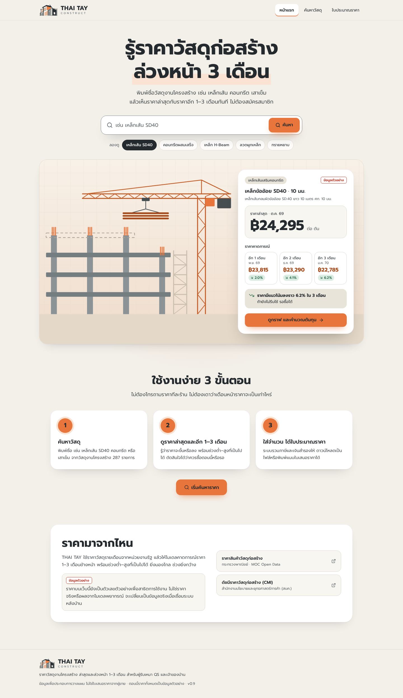
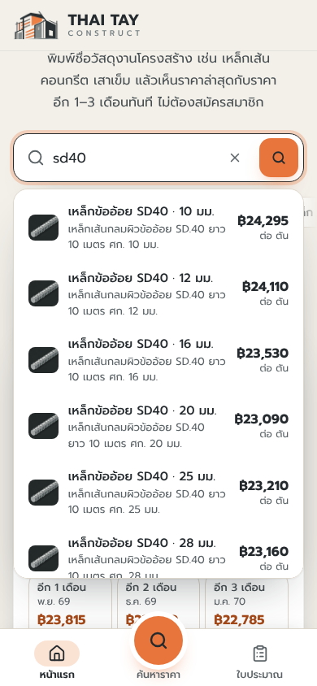
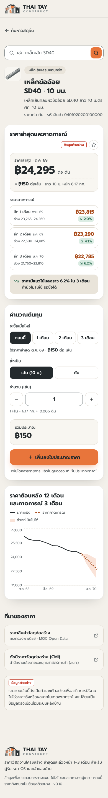
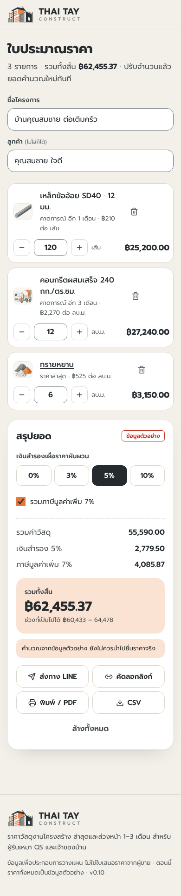
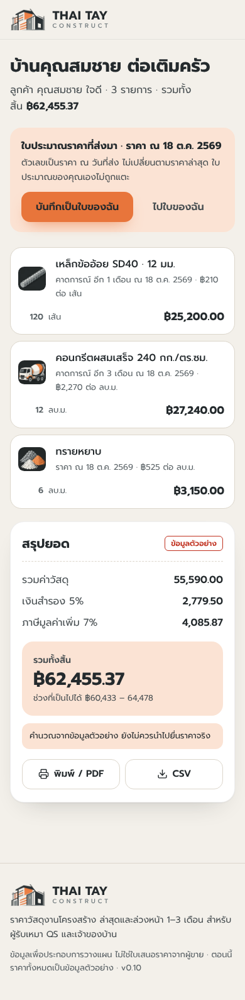

<p align="center"></p>

# THAI TAY

**รู้ราคาวัสดุก่อสร้างล่วงหน้า 3 เดือน**

พิมพ์ชื่อวัสดุงานโครงสร้าง เช่น เหล็กเส้น SD40 หรือคอนกรีตผสมเสร็จ แล้วเห็นราคาล่าสุดกับราคาคาดการณ์อีก 1–3 เดือนทันที ใส่จำนวนแล้วได้ใบประมาณราคาที่พิมพ์ บันทึกเป็น PDF หรือส่งทาง LINE ได้

เว็บที่ deploy อยู่: https://thaitay.vercel.app

> **สถานะ:** หน้าเว็บใช้งานได้ครบแล้ว (v0.10) แต่ยังไม่มี backend และยังไม่ได้ฝึกโมเดล ML ราคาทุกตัวบนเว็บตอนนี้เป็น **ข้อมูลตัวอย่าง** และมีป้าย "ข้อมูลตัวอย่าง" กำกับทุกการ์ดราคา ใบประมาณ และลิงก์ที่ส่งต่อ



## ภาพหน้าจอ

ถ่ายจาก build v0.10 ที่ความกว้าง 390 px

| ค้นหาจากหน้าแรก | หน้าวัสดุ | ใบประมาณราคา | ใบที่คนเปิดลิงก์เห็น |
| :---: | :---: | :---: | :---: |
|  |  |  |  |

ภาพจอใหญ่และไฟล์ PDF ตัวอย่างอยู่ในโฟลเดอร์ [`preview/`](preview)

## ใช้ทำอะไรได้

- **ค้นหาวัสดุ** 287 รายการใน 9 หมวดงานโครงสร้าง ช่องค้นหาเข้าใจคำหน้างาน เช่น "sd40" เจอ "SD.40", "ปูน", "ไวร์เมช", "เอชบีม", "4 หุน" และ "DB12"
- **ดูราคาและแนวโน้ม** หน้าวัสดุแสดงราคาล่าสุด ราคาคาดการณ์ 1–3 เดือนพร้อมช่วงต่ำ–สูง กราฟย้อนหลัง 12 เดือน และคำแนะนำว่าควรซื้อตอนนี้หรือรอ
- **เหล็กเส้นคิดเป็นเส้นได้** ร้านขายเป็นตันแต่หน้างานนับเป็นเส้น เว็บแปลงให้จากน้ำหนักมาตรฐาน 0.00617 × ศก.² กก./ม.
- **ใบประมาณราคา** ใส่ชื่อโครงการ ลูกค้า จำนวน เงินสำรอง และ VAT 7% แล้วพิมพ์เป็นใบเสนอราคา ดาวน์โหลด CSV หรือส่งลิงก์ทาง LINE ลิงก์เก็บรายการและราคา ณ วันที่ส่งไว้ในตัว จึงไม่ต้องมีเซิร์ฟเวอร์
- **ติดตามวัสดุ** กดดาวแล้ววัสดุนั้นขึ้นที่หน้าแรกพร้อมแนวโน้มราคา 3 เดือน
- **มือถือก่อน** แถบล่าง 3 ปุ่ม และไม่มีส่วนไหนล้นจอตั้งแต่ 320 px

### หมวดวัสดุ

เหล็กเส้นเสริมคอนกรีต · เหล็กรูปพรรณ · ตะแกรงเหล็กเสริมคอนกรีต · ลวดผูกเหล็ก · ลวดอัดแรง · คอนกรีตผสมเสร็จ · คอนกรีตหยาบ · เสาเข็มและชิ้นส่วนคอนกรีตสำเร็จรูป · มวลรวมคอนกรีต

งานสถาปัตยกรรม งานก่อผนัง สุขาภิบาล และไฟฟ้า อยู่นอกขอบเขต

## ข้อมูลราคามาจากไหน

รหัสวัสดุใช้รหัสสินค้า 16 หลักของกระทรวงพาณิชย์ (`MAT-…`) ราคาจริงจะมาจากสองแหล่งนี้ ตั้งค่าไว้ที่ `frontend/src/config/sources.ts`

| แหล่ง | หน่วยงาน | ใช้ทำอะไร |
|---|---|---|
| [ราคาสินค้าวัสดุก่อสร้าง](https://data.moc.go.th/OpenData/CSIProductIndexes) | กระทรวงพาณิชย์ (MOC Open Data) | ราคารายสินค้า รายเดือน แยกจังหวัด ใช้ฝึกโมเดล |
| [ดัชนีราคาวัสดุก่อสร้าง (CMI)](https://www.tpso.go.th/economic-data/construction-materials-price-index) | สนค. | ตรวจแนวโน้มภาพรวม |

## งานที่ยังเหลือ

1. **Backend** ให้บริการ 2 endpoint ที่หน้าเว็บรออยู่แล้ว
   - `GET /prices/{materialId}/history?months=1..12` ราคาย้อนหลัง
   - `GET /prices/{materialId}/forecast?months=1..3` ราคาคาดการณ์พร้อม `low` / `high`
2. **โมเดล ML** พยากรณ์ราคาแยกรายวัสดุ 1–3 เดือนล่วงหน้า ข้อมูลฝึกเตรียมไว้แล้ว และวางแผนใช้ Vertex AI
3. **เปลี่ยนจากข้อมูลตัวอย่างเป็นข้อมูลจริง** ตั้ง `VITE_API_BASE` ให้ชี้ไปที่ backend แล้ว build ใหม่ หน้าเว็บจะเลิกใช้ราคาตัวอย่างใน `frontend/src/services/demoPrices.ts`

หน้าเว็บจะยังไม่แสดงตัวเลขความแม่นยำของโมเดล จนกว่าจะมีผลจากโมเดลจริง

## เทคโนโลยี

| ส่วน | ที่ใช้ |
|---|---|
| Frontend | React 18, Vite 6, TypeScript, Tailwind CSS 4, shadcn/ui, Recharts |
| ข้อมูล | Python, Pandas (เตรียมข้อมูลราคาสำหรับฝึกโมเดล) |
| Deploy | Vercel (และ GitHub Pages ผ่าน `npm run deploy`) |

## รันในเครื่อง

ต้องมี Node.js 22.13 ขึ้นไป

```bash
cd frontend
npm ci
npm run dev        # เปิด URL ที่ Vite แสดง
npm run build      # ตรวจ TypeScript แล้ว build
npm run preview
```

ถ้าหน้าเว็บขาวและ console แจ้ง 404 ของไฟล์ `index-*.js` แปลว่า `base` ไม่ตรงกับ path ที่โฮสต์ ดูตารางหัวข้อ Deploy ใน [`frontend/README.md`](frontend/README.md)

## โครงสร้างโปรเจกต์

```text
THAITAY/
├── frontend/             เว็บ (React + Vite)
│   ├── src/pages/        หน้าแรก ค้นหา หน้าวัสดุ ใบประมาณราคา
│   ├── src/services/     ชั้นข้อมูลราคา: ข้อมูลตัวอย่าง หรือเรียก API เมื่อตั้ง VITE_API_BASE
│   ├── src/data/         รายชื่อวัสดุ 287 รายการ (ไม่มีราคา)
│   ├── README.md         รายละเอียดทุกไฟล์และวิธี deploy
│   ├── PRODUCT.md        ผู้ใช้ เป้าหมาย และหลักการของผลิตภัณฑ์
│   └── DESIGN.md         สี ตัวอักษร และ component
├── preview/              ภาพหน้าจอและผลตรวจของแต่ละเวอร์ชัน
├── START_HERE.md         วิธีเปิดบน Windows จากไฟล์ ZIP
└── CHANGES_v0.*.md       สิ่งที่เปลี่ยนในแต่ละเวอร์ชัน
```

## การตรวจสอบ

ผลตรวจ v0.10 อยู่ใน [`preview/verification.md`](preview/verification.md): `npm run build` ผ่าน, ทดสอบในเบราว์เซอร์ที่จอ 1440 และ 390 px ผ่าน 51 ข้อ, ไม่มีส่วนไหนล้นจอที่ 320 ถึง 1440 px และสีตัวหนังสือทุกคู่ผ่าน WCAG AA
